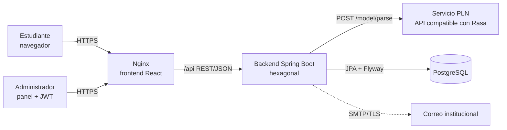

# Asistente Virtual Automatizado UPTC

Proyecto de **Ingeniería del Software II (2026)** — *Implementación de un Asistente Virtual Automatizado para la
Optimización del Soporte Informativo y la Gestión Administrativa en la UPTC*.
Adriam Camilo Macias Gavidia · Sergio Mauricio Parra Criado.

Chat 24/7 que responde en lenguaje natural las preguntas frecuentes de los estudiantes (admisiones,
matrículas, calendario, correo institucional, trámites) y escala a la dependencia correcta cuando no está
seguro, más un panel para que el personal administre las respuestas sin tocar código.

## Arquitectura



| Carpeta | Qué es | Tecnología |
| --- | --- | --- |
| [`frontend/`](frontend/) | Widget de chat del estudiante y panel administrativo | React 18 + Vite 7, Nginx |
| [`backend/`](backend/) | API REST, reglas del negocio, seguridad, métricas | Java 17, Spring Boot 3.4, JPA, Flyway, JWT |
| [`pln/`](pln/) | Motor de lenguaje natural: intención, confianza y entidades | Python 3.11, FastAPI, scikit-learn |
| [`datos/`](datos/) | Base de conocimiento (fuente única de intenciones, ejemplos y respuestas) | YAML |
| [`scripts/`](scripts/) | Generador de datos, prueba de punta a punta y prueba de carga | Python |
| [`docs/`](docs/) | Guía de despliegue | Markdown |

### Backend hexagonal (puertos y adaptadores, pauta 8.7)

```
co.edu.uptc.asistente
├── dominio            modelo (TextoConsulta, NivelConfianza, Intencion, SesionChat…), PoliticaEscalamiento, eventos
├── aplicacion
│   ├── puerto.entrada   ProcesarConsulta, GestionarSesiones, GestionarConocimiento, ConsultarMetricas,
│   │                    Autenticar, GestionarUsuarios, ConfigurarSistema
│   ├── puerto.salida    ClasificadorIntencion, RepositorioIntenciones, RepositorioSesiones, NotificadorEscalamiento…
│   └── casodeuso        ServicioConversacion, ServicioConocimiento, ServicioMetricas…  (Java puro, sin Spring)
└── infraestructura
    ├── entrada          REST (ChatController, IntencionesController…), tareas programadas
    ├── salida           RasaAdapter (+ circuit breaker), adaptadores JPA, caché CQRS, correo SMTP, eventos
    └── seguridad        JWT (8 h), BCrypt, CORS, cabeceras
```

El núcleo (`dominio` + `aplicacion`) no importa nada de Spring: se prueba con adaptadores falsos en memoria.
Cambiar el motor PLN (Rasa, Dialogflow o el servicio liviano) o la base de datos solo cambia un adaptador.

Patrones aplicados que se pueden ver en el código: capas y hexagonal, DDD (agregados, objetos de valor,
servicios de dominio, eventos), **EventSourcing** (tabla `eventos` de solo inserción; historial de cada
intención), **CQRS** ligero (caché de lectura de la base de conocimiento), orientado a eventos (registro,
correo y reentrenamiento en segundo plano), **Circuit Breaker** hacia el PLN, Repository, Strategy/Observer.

## Ejecutarlo

**Todo junto con Docker** (lo más fácil):

```bash
cp .env.example .env
docker compose up -d --build
```

Chat en <http://localhost>, panel en <http://localhost/admin> (`admin@uptc.edu.co` / `Admin2026*`, superadministrador;
`gestor@uptc.edu.co` / `Gestor2026*`, administrador) y API documentada en <http://localhost/swagger-ui.html>.
Cambia esas contraseñas apenas lo despliegues. Para publicarlo gratis en internet ver
[`docs/DESPLIEGUE.md`](docs/DESPLIEGUE.md).

**Por partes, para desarrollar:**

```bash
# 1. Motor PLN (puerto 5005)
cd pln && pip install -r requirements-dev.txt && uvicorn app.main:app --port 5005

# 2. Backend (puerto 8080) con H2 en archivo, sin instalar PostgreSQL
cd backend && mvn spring-boot:run -Dspring-boot.run.profiles=dev

# 3. Frontend (puerto 5173) conectado al backend
cd frontend && npm install && VITE_USE_MOCK=false npm run dev
```

El frontend también funciona solo, sin backend (`npm run dev` con `VITE_USE_MOCK=true`): usa un motor PLN
simulado y guarda los datos en el navegador.

## Pruebas

| Comando | Qué prueba |
| --- | --- |
| `cd backend && mvn verify` | 65 pruebas: dominio y casos de uso (caja blanca, valores límite), integración de la API con H2, adaptador del PLN y JWT. Cobertura en `target/site/jacoco/index.html` |
| `cd pln && pytest` | Normalización, entidades, clasificador y API HTTP |
| `cd pln && python -m app.evaluar` | Exactitud del modelo en el conjunto de validación (RF-02, meta 85 %) |
| `cd frontend && npm test` | Cliente de la API, utilidades y motor simulado (Vitest) |
| `python scripts/prueba_e2e.py http://localhost` | Punta a punta con el sistema desplegado, incluido el reentrenamiento automático |
| `python scripts/prueba_carga.py http://localhost 100 5` | 100 usuarios concurrentes (RNF-05) |

GitHub Actions ([`.github/workflows/ci.yml`](.github/workflows/ci.yml)) corre todo lo anterior en cada push y,
al final, levanta el sistema con Docker Compose y ejecuta la prueba E2E y la de carga.

## Base de conocimiento

`datos/base_conocimiento.yml` tiene las 34 intenciones (31 temáticas y 3 sociales), 338 frases de entrenamiento
y las respuestas. Después de editarlo:

```bash
pip install pyyaml bcrypt
python scripts/generar_datos.py   # regenera pln/data/nlu.yml y la semilla SQL
```

Desde el panel también se crean intenciones con sus ejemplos y el motor PLN se reentrena solo.
Los textos, correos y enlaces son **de demostración**: el enlace institucional debe validarlos antes del
piloto (RD-01, RD-03, RD-04).

## Relación con los requisitos

| Requisito | Dónde se cumple |
| --- | --- |
| RF-01 Consulta ≤ 500 caracteres | `TextoConsulta` (dominio) + contador del `InputBox` |
| RF-02 Intención, entidades, confianza (≥ 85 %) | Servicio PLN + `RasaAdapter`; `python -m app.evaluar` |
| RF-03 / RF-04 Respuesta automática, ≥ 30 intenciones | `ServicioConversacion`, `SelectorRespuesta`; 31 intenciones temáticas |
| RF-05 Escalamiento < 60 % | `PoliticaEscalamiento` + `EscalationCard` con datos de la dependencia |
| RF-06 Registro sin datos personales | Tabla `consultas`, sesiones anónimas `SES-AAAA-XXXXXXXX` |
| RF-07 Panel, cambios en < 5 min sin reiniciar | Caché invalidada por evento; reentrenamiento automático del PLN |
| RNF-01 / RNF-05 Tiempo de respuesta | Medido en la prueba E2E y en la de carga |
| RNF-02 Disponibilidad ≥ 95 % | Chequeos de salud cada minuto; indicador real en el dashboard |
| RNF-03 Seguridad | JWT 8 h, BCrypt, bloqueo tras 5 intentos, roles, CORS, cabeceras, auditoría |
| RNF-07 Mantenibilidad | Base de conocimiento editable desde el panel; arquitectura hexagonal |
| RNF-08 Fiabilidad | Timeouts, circuit breaker, 503 con datos de contacto, aviso sin conexión |
| UC-14 / UC-15 / UC-16 | Páginas Usuarios, Historial (CSV) y Configuración del panel |
